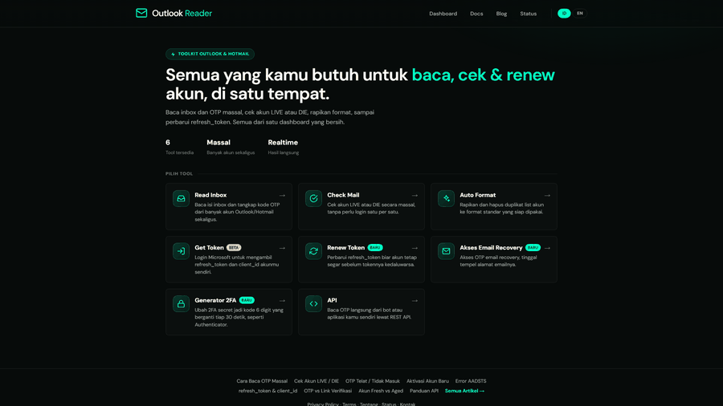

<p align="center">
  <a href="https://outlookreader.my.id">
    
  </a>
</p>

<h1 align="center">Outlook Reader</h1>

Alat gratis untuk membaca inbox dan menangkap kode OTP akun Outlook/Hotmail secara massal lewat Microsoft Graph API dan OAuth2. Cek akun LIVE atau DIE, rapikan format, renew token, baca OTP email recovery, sampai generator 2FA. Semua dari satu dashboard yang bersih.

Website: **https://outlookreader.my.id**
Dokumentasi API: **https://outlookreader.my.id/docs**

> Repo ini berisi dokumentasi dan panduan penggunaan. Aplikasi berjalan di website di atas.

## Tampilan



---

## Fitur

- **Read Inbox** - baca isi inbox banyak akun Outlook/Hotmail sekaligus, langsung menyorot kode OTP yang terdeteksi.
- **Check Mail** - cek akun LIVE atau DIE secara massal, tanpa login satu per satu.
- **Auto Format** - rapikan dan hapus duplikat list akun ke format standar.
- **Renew Token** - perbarui `refresh_token` biar akses mailbox tidak putus sebelum token kedaluwarsa.
- **Akses Email Recovery** - baca kode OTP yang dikirim Microsoft ke email recovery, cukup tempel alamatnya.
- **Generator 2FA** - ubah 2FA secret (base32) jadi kode 6 digit TOTP yang berganti tiap 30 detik, plus mode massal.
- **REST API** - baca OTP langsung dari bot atau aplikasi kamu sendiri lewat API berbasis key.

## Format akun

```
email|password|refresh_token|client_id
```

Opsional dengan email recovery di akhir:

```
email|password|refresh_token|client_id|recovery_email
```

## Cara pakai (web)

1. Buka https://outlookreader.my.id
2. Pilih tool yang kamu butuh (Read Inbox, Check Mail, Renew Token, dll).
3. Tempel akun sesuai format, satu akun per baris.
4. Jalankan. OTP dan hasil muncul langsung di browser.

## REST API (untuk reseller / bot)

API publik untuk membaca OTP dari aplikasi atau bot sendiri. Butuh API key yang diajukan lewat bot Telegram dan disetujui admin.

Endpoint utama:

- `POST /api/v1/otp` - baca satu akun, kembalikan OTP terbaru + daftar pesan.
- `POST /api/v1/otp/bulk` - baca banyak akun sekaligus (maks 25 per request).
- `GET /api/v1/whoami` - cek status dan pemakaian key.

Contoh (curl):

```bash
curl -X POST https://outlookreader.my.id/api/v1/otp \
  -H "X-API-Key: rdr_xxxxxxxxxxxxxxxx" \
  -H "Content-Type: application/json" \
  -d '{"credentials":"email|password|refresh_token|client_id"}'
```

Dokumentasi lengkap (field, status, rate limit, contoh Node/Python, Postman): **https://outlookreader.my.id/docs**

## FAQ

**Apakah perlu login ke Microsoft?**
Tidak. Pembacaan mailbox memakai `refresh_token` yang kamu punya, bukan login username/password.

**Kenapa OTP tidak muncul padahal akun hidup?**
OTP bisa telat dikirim Microsoft, atau kode verifikasi Microsoft dikirim ke email recovery, bukan inbox utama. Pakai fitur Akses Email Recovery untuk yang itu.

**Kenapa semua akun gagal dengan error AADSTS70000 / invalid_grant?**
`refresh_token` akun sudah mati atau dicabut. Ambil token baru lewat login Microsoft, atau pakai Renew Token selama token lama masih valid.

**Apakah ada rate limit API?**
Ya, per key dibatasi per menit, dan ada batas per-IP. Detail di dokumentasi.

## Panduan

Kumpulan artikel panduan ada di **https://outlookreader.my.id/blog**, antara lain:

- Cara membaca kode OTP dari email recovery Outlook
- Kapan `refresh_token` kedaluwarsa dan cara memperbaruinya
- Arti error invalid_grant dan cara mengatasinya
- Beda email utama dan email recovery di akun Outlook

## Kontak

Telegram: **@outlookmilobot**

---

Outlook Reader. Alat bantu baca OTP dan kelola akun Outlook/Hotmail.
